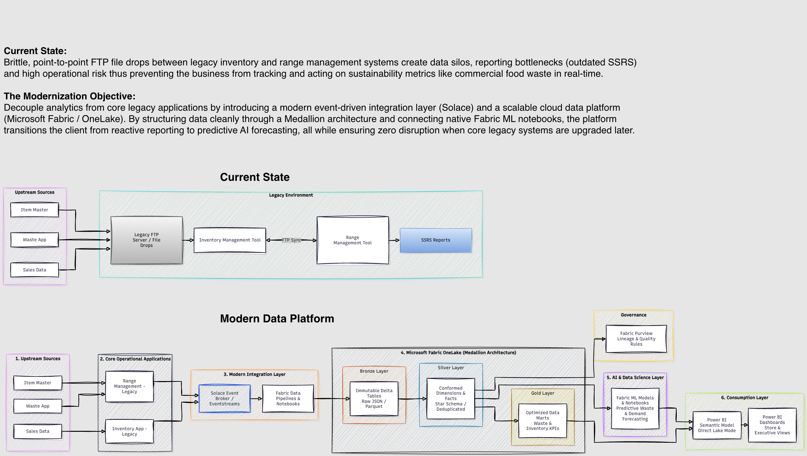

# Enterprise AI Readiness Framework

**Data Products | Data Governance | Microsoft Fabric | Semantic Models | Knowledge Graphs | AI Strategy**

---

## Overview

This repository contains frameworks, reference architectures, and operating models that help organizations build trusted, AI-ready data foundations.

The content is based on practical experience in enterprise data platforms, analytics, governance, and data product management.

---

## Core Themes

### Data Products
Treating data as a product with clear ownership, quality standards, and measurable business value.

### Data Governance
Establishing accountability, stewardship, trust, and compliance.

### Microsoft Fabric
Reference architectures and transformation approaches for modern analytics platforms.

### Semantic Layer
Making data understandable and accessible to business users and AI systems.

### Knowledge Graphs
Providing business context and relationships to support AI-driven decision making.

### Enterprise AI Strategy
Connecting data foundations to business outcomes and AI adoption.

---

## Featured Architecture

### Commercial Food Waste Modernization

#### Business Challenge

Legacy inventory and range management systems relied on FTP-based integrations and disconnected reporting systems, creating data silos, operational risk, and delayed visibility into sustainability metrics.

#### Modernization Approach

The target-state architecture introduces:

- Event-driven integration
- Microsoft Fabric OneLake
- Medallion Architecture
- Data Governance and Data Quality controls
- Machine Learning forecasting capabilities
- Executive dashboards and sustainability reporting

#### Architecture Diagram



---

## Repository Structure

```text
enterprise-ai-readiness-framework
│
├── ai-readiness-playbook
├── fabric-reference-architecture
├── data-product-operating-model
├── governance-framework
├── diagrams
└── presentations
```

---

## Roadmap

### Currently Under Playbook
- Microsoft Fabric Reference Architecture
- Data Product Operating Model
- Enterprise Data Governance Framework
- AI Adoption and Governance Playbook

### Planned Deliverables

- Executive Presentation Decks
- Assessment Templates
- Strategy Frameworks
- Architecture Diagrams
- AI Readiness Assessments

---

## About the Author

### Thivakar Allimuthu

Data Product Owner with 18+ years of experience delivering enterprise-scale data, analytics, governance, and master data management solutions.

#### Areas of Expertise

- Data Product Ownership
- Enterprise Data Platforms
- Data Governance
- Master Data Management (MDM)
- Analytics Modernization
- Platform Operations
- Data Strategy

#### Current Focus

- Microsoft Fabric
- Enterprise AI Strategy
- AI Readiness Frameworks
- Semantic Models
- Knowledge Graphs
- Responsible AI Adoption

#### Connect

- LinkedIn: https://www.linkedin.com/in/thivakar-allimuthu
- GitHub: https://github.com/thivakar-allimuthu
