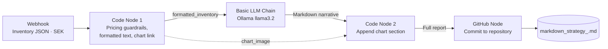

# 🏷️ Autonomous Pricing & Markdown Agent

An end-to-end, locally run **GitOps pipeline** that turns raw retail inventory data into a grounded **executive pricing report** (with a price comparison chart) and commits it to GitHub automatically.

Built on macOS with **Docker**, **n8n**, **Ollama (llama3.2)**, **JavaScript** and **GitHub**.

> **Design principle:** deterministic code does the math, the LLM only writes the narrative.

---

## 📑 Table of Contents

- [Overview](#-overview)
- [Architecture](#-architecture)
- [Tech Stack](#-tech-stack)
- [Input Payload](#-input-payload)
- [Pipeline Stages](#-pipeline-stages)
- [Worked Example](#-worked-example)
- [Issues Encountered & Fixes](#-issues-encountered--fixes)
- [Setup](#-setup)
- [Usage](#-usage)
- [Output](#-output)
- [Known Limitations](#-known-limitations)
- [Project Status](#-project-status)
- [Possible Next Steps](#-possible-next-steps)

---

## 🔎 Overview

Retail pricing teams need fast, consistent markdown recommendations. Asking an LLM to do the arithmetic is risky: it drifts, invents numbers and breaks pricing guardrails. This project separates the concerns:

| Concern | Handled by |
|---|---|
| Price floors, competitor undercutting, markdown %, margin %, chart data | **JavaScript Code node** (deterministic) |
| Executive Summary, Pricing Action Table, Total Capital Recoverable Estimate | **Local LLM** via Ollama (narrative only) |
| Appending the visual price chart to the report | **JavaScript Code node** |
| Versioned, auditable delivery of reports | **GitHub** (GitOps) |

The LLM runs locally, so inventory data is not sent to a third-party AI service. The only external calls are the GitHub commit and the chart image link (see [Known Limitations](#-known-limitations)).

---

## 🏗️ Architecture



---

## 🧰 Tech Stack

| Layer | Tool |
|---|---|
| Orchestration | [n8n](https://n8n.io) (Docker) |
| Local LLM runtime | [Ollama](https://ollama.com) (Docker) |
| Model | `llama3.2:latest` |
| Business logic | JavaScript (n8n Code nodes) |
| Chart rendering | [QuickChart](https://quickchart.io) (image URL) |
| Delivery | GitHub (n8n GitHub node) |
| Host | macOS |

---

## 📥 Input Payload

The webhook accepts inventory items as JSON. All monetary values are in **SEK**.

| Field | Type | Description |
|---|---|---|
| `sku` | String | Unique product identifier (e.g. `SKU-4089`) |
| `product_name` | String | Plain-text product description |
| `category` | String | Product category (e.g. Electronics) |
| `cost_price_sek` | Number | Wholesale or production cost, used to enforce the margin floor |
| `current_price_sek` | Number | Current listing price in Swedish Kronor |
| `competitor_price_sek` | Number | Competitor market price, used for undercutting logic |
| `days_in_stock` | Number | Inventory age |
| `units_in_stock` | Number | Units currently on hand |
| `sales_velocity_30d` | Number | Units sold in the last 30 days |

> **Note:** the current pricing logic uses `cost_price_sek`, `current_price_sek` and `competitor_price_sek`. The other fields are carried in the payload for future use (see [Possible Next Steps](#-possible-next-steps)).

### Example

```json
[
  {
    "sku": "SKU-4089",
    "product_name": "Pro Noise-Canceling Headphones",
    "category": "Electronics",
    "cost_price_sek": 1200,
    "current_price_sek": 2499,
    "competitor_price_sek": 2199,
    "days_in_stock": 78,
    "units_in_stock": 140,
    "sales_velocity_30d": 2
  },
  {
    "sku": "SKU-9912",
    "product_name": "Ergonomic Mesh Office Chair",
    "category": "Furniture",
    "cost_price_sek": 1800,
    "current_price_sek": 4500,
    "competitor_price_sek": 4200,
    "days_in_stock": 115,
    "units_in_stock": 85,
    "sales_velocity_30d": 1
  },
  {
    "sku": "SKU-1043",
    "product_name": "Waterproof Trail Backpack 30L",
    "category": "Outdoor",
    "cost_price_sek": 350,
    "current_price_sek": 899,
    "competitor_price_sek": 849,
    "days_in_stock": 92,
    "units_in_stock": 210,
    "sales_velocity_30d": 4
  }
]
```

---

## ⚙️ Pipeline Stages

### 1. Webhook (POST)
Receives the inventory payload and starts the workflow.

### 2. Code Node 1: deterministic pricing engine
LLMs are unreliable at exact arithmetic, so this node performs **100% of the calculations** before any data reaches the model.

| Rule | Logic | Purpose |
|---|---|---|
| **Margin floor** | `floor = cost_price_sek × 1.15` | A recommended price never drops below 15% above cost |
| **Competitor undercut** | If `competitor_price < current_price`: `target = max(competitor × 0.98, floor)` | Undercut the cheaper competitor by 2%, but never breach the floor |
| **No price increases** | If the competitor is not cheaper, `target = current_price` | The engine only recommends holding or lowering prices |
| **Rounding** | `Math.round(target)` | Whole-SEK recommended prices |

**Calculated fields per SKU**

- `markdown_percent = (current − target) / current × 100`
- `profit_margin_percent = (target − cost) / target × 100` (margin on selling price)

The node then:

1. Formats each SKU as one plain-text line (`formatted_inventory`), which removes LLM parsing and calculation errors.
2. Builds a **QuickChart** bar chart configuration (current vs recommended price per SKU), Base64-encodes it, and stores it as a Markdown image link (`chart_image`).

<details>
<summary>View the Code Node 1 source</summary>

```javascript
const skus = [];
const currentPrices = [];
const recommendedPrices = [];

const formattedList = $input.all().map(item => {
  const data = item.json;
  const minFloor = data.cost_price_sek * 1.15;
  let targetPrice = data.current_price_sek;

  if (data.competitor_price_sek < data.current_price_sek) {
    const undercut = data.competitor_price_sek * 0.98;
    targetPrice = Math.max(undercut, minFloor);
  }

  const roundedTarget = Math.round(targetPrice);
  const markdownPct = ((data.current_price_sek - targetPrice) / data.current_price_sek) * 100;
  const profitMarginPct = ((targetPrice - data.cost_price_sek) / targetPrice) * 100;

  skus.push(data.sku);
  currentPrices.push(data.current_price_sek);
  recommendedPrices.push(roundedTarget);

  return `- SKU: ${data.sku} | Name: ${data.product_name} | Current: ${data.current_price_sek} SEK | Recommended: ${roundedTarget} SEK | Markdown: ${markdownPct.toFixed(1)}% | Margin: ${profitMarginPct.toFixed(1)}%`;
}).join('\n');

// Build QuickChart configuration object
const chartConfig = {
  type: 'bar',
  data: {
    labels: skus,
    datasets: [
      { label: 'Current Price (SEK)', data: currentPrices },
      { label: 'Recommended Price (SEK)', data: recommendedPrices }
    ]
  }
};

// Encode JSON to Base64 to make it safe for standard Markdown links
const jsonString = JSON.stringify(chartConfig);
const base64Config = Buffer.from(jsonString).toString('base64');
const chartImageMarkdown = ``;

return [{
  json: {
    formatted_inventory: formattedList,
    chart_image: chartImageMarkdown
  }
}];
```

</details>

### 3. Basic LLM Chain + Ollama (`llama3.2`)
A direct text-in, text-out step. The chain receives the `formatted_inventory` string and writes a Markdown narrative with:

1. **Executive Summary**
2. **Pricing Action Table**
3. **Total Capital Recoverable Estimate**

Strict prompt rules keep the output clean: narrative text only, no charts or code blocks, and no disclaimers or conversational notes. The model focuses on presentation, not math.

### 4. Code Node 2: report assembly
Takes the LLM narrative and appends a `## Visual Chart` section containing the QuickChart image link from Code Node 1.

### 5. GitHub Node: GitOps target
Commits the final report to the repository with a **timestamped filename**, so reports never overwrite each other:

```
case-studies/Autonomous-Pricing-Markdown/markdown_strategy_2026-10-23_14-30-05.md
```

File path expression: `markdown_strategy_{{ $now.toFormat('yyyy-MM-dd_HH-mm-ss') }}.md`

Commit message: `feat: automated retail markdown strategy update [ci skip]`

---

## 🧮 Worked Example

Applying the rules above to the sample payload:

| SKU | Cost | Floor (×1.15) | Current | Competitor | Undercut (×0.98) | **Recommended** | Markdown | Margin |
|---|---|---|---|---|---|---|---|---|
| SKU-4089 | 1,200 | 1,380 | 2,499 | 2,199 | 2,155 | **2,155 SEK** | 13.8% | 44.3% |
| SKU-9912 | 1,800 | 2,070 | 4,500 | 4,200 | 4,116 | **4,116 SEK** | 8.5% | 56.3% |
| SKU-1043 | 350 | 402.5 | 899 | 849 | 832 | **832 SEK** | 7.5% | 57.9% |

In all three cases the undercut price is above the margin floor, so the floor does not bind. All values are in SEK.

---

## 🛠️ Issues Encountered & Fixes

| # | Issue | Root cause | Fix |
|---|---|---|---|
| 1 | **LLM hallucinations & math drift**: invented products (Coffee Maker, TV) and wrong currency (USD instead of SEK) | Complex JSON injected into an AI Agent node; the LLM was also doing the arithmetic | Moved all math into a JavaScript Code node; replaced the JSON payload with a pre-formatted plain-text string; **switched from the AI Agent node to the Basic LLM Chain** to avoid agent-loop fallbacks |
| 2 | **GitHub API validation error**: `"sha" wasn't supplied` | Fields were set as literal *Fixed* strings | Configured the fields in **Expression mode (`fx`)** |
| 3 | **File name collisions & messy dates** | Static file name | Used the Luxon expression `{{ $now.toFormat('yyyy-MM-dd_HH-mm-ss') }}` for unique, clean names |
| 4 | **Chart links breaking in Markdown** | Raw JSON in a URL contains characters that break Markdown links | Base64-encoded the QuickChart config (`encoding=base64`) |

### Why not the AI Agent node?
The n8n AI Agent node introduced hallucinated products and incorrect currencies earlier in the build. For a task that is "format this text into a report", the Basic LLM Chain is simpler, more predictable and easier to debug. The Agent node is still in the workflow file, but disabled.

---

## 🚀 Setup

> The commands below are a starting point. Adjust ports, volumes and image tags to your environment.

### Prerequisites

- macOS with [Docker Desktop](https://www.docker.com/products/docker-desktop/)
- A GitHub repository for the reports and a [personal access token](https://github.com/settings/tokens) with repo write access

### 1. Run Ollama and pull the model

```bash
docker run -d --name ollama -p 11434:11434 -v ollama:/root/.ollama ollama/ollama
docker exec -it ollama ollama pull llama3.2
```

### 2. Run n8n

```bash
docker run -d --name n8n -p 5678:5678 -v n8n_data:/home/node/.n8n docker.n8n.io/n8nio/n8n
```

Open <http://localhost:5678>.

### 3. Import the workflow

1. In n8n, choose **Import from file** and select `Autonomous Pricing & Markdown Agent.json` from this repository.
2. **Ollama Chat Model:** create an Ollama credential with a base URL n8n can reach (e.g. `http://host.docker.internal:11434`, or the container name if both share a Docker network), and select `llama3.2:latest`.
3. **GitHub node:** add your GitHub credential, then set your own owner, repository and target folder.
4. Keep the GitHub file path and content fields in **Expression mode (`fx`)**.
5. Activate the workflow.

> Credentials are not included in the workflow file. You must create your own.

---

## ▶️ Usage

Send the inventory payload to the webhook (use the **Production URL** shown on the Webhook node once the workflow is active):

```bash
curl -X POST http://localhost:5678/webhook/<your-webhook-id> \
  -H "Content-Type: application/json" \
  -d @payload.json
```

A new report appears in your GitHub repository within moments.

---

## 📄 Output

Each report contains:

- **Executive Summary**: key findings across the SKUs
- **Pricing Action Table**: per-SKU recommended price, markdown % and margin %
- **Total Capital Recoverable Estimate**: estimated recoverable capital
- **Visual Chart**: bar chart comparing current and recommended prices per SKU

Reports reference the real SKUs from the payload, with all figures in **SEK**.

> 💡 _Tip: link to an example report in `case-studies/Autonomous-Pricing-Markdown/` here to show real output._

---

## ⚠️ Known Limitations

- **The Total Capital Recoverable Estimate is generated by the LLM**, not calculated in JavaScript, so it is the one figure not covered by the deterministic guardrails.
- **Chart data leaves your machine:** the QuickChart image link embeds the SKUs and prices in the URL, so they are sent to quickchart.io when the image is rendered.
- **No price increases:** the engine only holds or lowers prices.
- **`days_in_stock`, `units_in_stock` and `sales_velocity_30d` are not yet used** in the pricing logic or the report.
- **Small local model:** a 3B model can still vary in wording, so keep the prompt strict and review reports before acting on them.

---

## ✅ Project Status

**Fully operational end-to-end.** The pipeline ingests inventory, applies pricing guardrails, generates a grounded executive report with a chart and pushes the commit to GitHub.

---

## 🔭 Possible Next Steps

- Calculate the Total Capital Recoverable Estimate in JavaScript and pass it to the LLM as text
- Use `days_in_stock`, `units_in_stock` and `sales_velocity_30d` for overstock-based markdown depth
- Add input validation and error handling on the webhook
- Schedule runs (cron) or trigger from a live inventory source
- Add automated tests for the pricing rules
- Make the margin floor (15%) and undercut (2%) configurable
- Add a Slack or email notification when a new report is committed

---

## 📜 License

TBD
