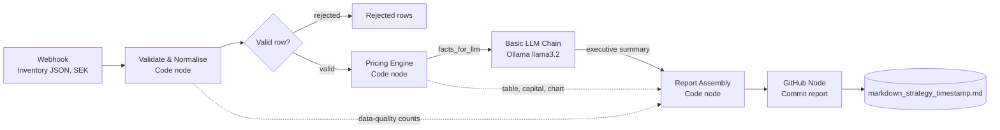

# 🏷️ Autonomous Pricing & Markdown Agent

An end-to-end, locally run **GitOps pipeline** that validates retail inventory data, applies a rules-based pricing and markdown engine, and commits an **executive pricing report** (with a price comparison chart) to GitHub automatically.

Built on macOS with **Docker**, **n8n**, **Ollama (llama3.2)**, **JavaScript** and **GitHub**.

> **Design principle:** deterministic code makes every pricing decision and calculates every number. The LLM only writes a short narrative on top.

---

## 📑 Table of Contents

- [Overview](#-overview)
- [Architecture](#-architecture)
- [Tech Stack](#-tech-stack)
- [Repository Layout](#-repository-layout)
- [Input Payload (v2)](#-input-payload-v2)
- [Pipeline Stages](#-pipeline-stages)
  - [1. Webhook](#1-webhook-post)
  - [2. Validate & Normalise](#2-validate--normalise)
  - [3. Pricing Engine](#3-pricing-engine)
  - [4. LLM Executive Summary](#4-llm-executive-summary)
  - [5. Report Assembly](#5-report-assembly)
  - [6. GitHub Commit](#6-github-commit)
- [Example Results](#-example-results)
- [Design Decisions & Issues Fixed](#-design-decisions--issues-fixed)
- [Setup](#-setup)
- [Testing](#-testing)
- [Known Limitations](#-known-limitations)
- [Roadmap](#-roadmap)

---

## 🔎 Overview

Retail pricing teams need fast, consistent and explainable markdown recommendations. Asking an LLM to do the arithmetic is risky: it drifts, invents numbers and breaks pricing guardrails. This project separates the concerns:

| Concern | Handled by |
|---|---|
| Data validation, GTIN check, duplicate detection | **JavaScript** (Validate & Normalise node) |
| Price floors, competitor undercutting, aging and stock-cover markdowns, price endings, action labels | **JavaScript** (Pricing Engine node) |
| Pricing table, capital estimate, chart, data-quality section | **JavaScript** (Pricing Engine and Report Assembly nodes) |
| Executive summary narrative (4 to 6 sentences) | **Local LLM** via Ollama |
| Versioned, auditable delivery of reports | **GitHub** (GitOps) |

The LLM runs locally, so inventory data is not sent to a third-party AI service. The only external calls are the GitHub commit and the chart image link (see [Known Limitations](#-known-limitations)).

---

## 🏗️ Architecture



---

## 🧰 Tech Stack

| Layer | Tool |
|---|---|
| Orchestration | [n8n](https://n8n.io) (Docker) |
| Local LLM runtime | [Ollama](https://ollama.com) (Docker) |
| Model | `llama3.2:latest` |
| Business logic | JavaScript (n8n Code nodes) |
| Chart rendering | [QuickChart](https://quickchart.io) (image URL) |
| Delivery | GitHub (n8n GitHub node) |
| Host | macOS |

---

## 📁 Repository Layout

Suggested structure for publishing:

```
.
├── README.md
├── workflow/
│   └── Autonomous Pricing & Markdown Agent.json   # n8n workflow export
├── code/
│   ├── validate_and_normalise.js                  # Step 1: validation node
│   ├── pricing_engine.js                          # Step 2: pricing engine node
│   ├── report_assembly.js                         # Step 2: report assembly node
│   └── llm_prompt.txt                             # Basic LLM Chain prompt
├── sample-data/
│   ├── payload_v2_clean.json                      # 15 valid SKUs
│   └── payload_v2_with_errors.json                # 23 rows: 5 rejected, 3 with warnings
└── case-studies/Autonomous-Pricing-Markdown/      # generated reports land here
```

---

## 📥 Input Payload (v2)

The webhook accepts inventory items as JSON (an array, or single objects). All monetary values are in **SEK**.

| Field | Type | Required | Description |
|---|---|---|---|
| `sku` | String | ✅ | Unique product identifier |
| `gtin` | String | optional | GTIN-8/12/13/14, validated with the GS1 check digit |
| `product_name` | String | ✅ | Plain-text product description |
| `brand` | String | optional | Brand |
| `department` | String | ✅ | Top of the hierarchy; selects the margin floor |
| `category` | String | ✅ | Product category |
| `subcategory` | String | optional | Product subcategory |
| `supplier` | String | optional | Supplier |
| `cost_price_sek` | Number | ✅ | Wholesale or production cost (must be > 0) |
| `current_price_sek` | Number | ✅ | Current listing price (must be > 0) |
| `competitor_prices_sek` | Number[] | optional | One or more competitor prices; empty or missing is allowed with a warning |
| `days_in_stock` | Number | ✅ | Inventory age in days |
| `units_in_stock` | Integer | ✅ | Units on hand |
| `sales_velocity_30d` | Number | ✅ | Units sold in the last 30 days |
| `days_since_last_price_change` | Number | optional | Used for the price-change cooldown |

The legacy single field `competitor_price_sek` is still accepted.

### Example item

```json
{
  "sku": "SKU-4089",
  "gtin": "7350001000015",
  "product_name": "Pro Noise-Canceling Headphones",
  "brand": "Nordtone",
  "department": "Electronics",
  "category": "Audio",
  "subcategory": "Headphones",
  "supplier": "Sonic Supply AB",
  "cost_price_sek": 1200,
  "current_price_sek": 2499,
  "competitor_prices_sek": [2199, 2249, 2179],
  "days_in_stock": 78,
  "units_in_stock": 140,
  "sales_velocity_30d": 2,
  "days_since_last_price_change": 45
}
```

---

## ⚙️ Pipeline Stages

### 1. Webhook (POST)
Receives the inventory payload and starts the workflow.

### 2. Validate & Normalise
A data-quality gate that runs before any pricing logic. Each row is either **accepted**, **accepted with warnings**, or **rejected**.

| Result | Triggers |
|---|---|
| ❌ **Rejected** (not priced) | Missing `sku`, `product_name`, `department` or `category`; duplicate `sku`; non-numeric or non-positive cost or price; invalid stock, age or velocity values; invalid GTIN format or GS1 check digit; non-numeric competitor values |
| ⚠️ **Warning** (still priced) | Missing GTIN; current price below cost; no competitor prices; competitor price that looks like an outlier; stock older than 730 days |

The node also **normalises** the data: numeric strings become numbers, it unwraps the webhook body, and it derives `competitor_min_sek`, `competitor_median_sek` and `competitor_max_sek`. An IF node then routes rejected rows to a separate branch, and valid rows continue.

### 3. Pricing Engine
All pricing decisions and calculations happen here, in plain JavaScript.

**Decision order for each SKU**

| # | Check | Outcome |
|---|---|---|
| 1 | No stock on hand | `HOLD` |
| 2 | Current price is below the margin floor | `REVIEW` (never raised automatically) |
| 3 | Price changed in the last 14 days | `HOLD` (cooldown) |
| 4 | Fast mover: 8 weeks of cover or less **and** 60 days in stock or less | `HOLD` |
| 5 | Otherwise: target = the lower of (cheapest credible competitor minus 2%) and (current price minus the stock-pressure markdown) | `MARKDOWN` or `CLEARANCE` |

**Guardrails applied to the target price**

- **Margin floor by department:** `cost × (1 + markup)`: Electronics +10%, Furniture +25%, Outdoor, Home and Sports +20%, others +15%.
- **Maximum markdown:** no price falls more than 25% in a single run.
- **Competitor outliers:** competitor prices below 50% of our price are ignored.
- **Price endings:** prices round **up** to the next number ending in 9, never above the current price.
- **Minimum step:** changes under 1% are ignored.

**Stock-pressure markdown** (capped at 30% in total)

| Days in stock | Depth | | Weeks of cover | Depth |
|---|---|---|---|---|
| 0 to 30 | 0% | | up to 8 | 0% |
| 31 to 60 | 3% | | 9 to 13 | 3% |
| 61 to 90 | 8% | | 14 to 26 | 6% |
| 91 to 120 | 15% | | 27 to 52 | 12% |
| over 120 | 25% | | over 52 | 20% |

Weeks of cover = `units_in_stock ÷ (sales_velocity_30d × 7 ÷ 30)`.

**Action labels**

| Label | Meaning |
|---|---|
| `HOLD` | Price unchanged (fast mover, cooldown, no stock, or change too small) |
| `MARKDOWN` | Price reduced |
| `CLEARANCE` | Price reduced, with 120+ days in stock **and** 26+ weeks of cover |
| `REVIEW` | Current price is below the margin floor; needs a human decision |

Markdowns of **15% or more** are flagged ⚠️ as recommended for human approval.

**Deterministic outputs**

- Per-SKU recommended price, markdown %, margin % (on selling price) and a plain-text reason
- The full **Pricing Action Table** in Markdown
- The **Total Capital Recoverable Estimate** (below)
- A QuickChart bar chart link (current vs recommended price, Base64-encoded)
- A short `facts_for_llm` block for the language model

All thresholds live in a single `CONFIG` object at the top of the node, so they can be tuned without touching the logic.

**Capital metrics** (for `MARKDOWN` and `CLEARANCE` SKUs only)

| Metric | Formula |
|---|---|
| Capital tied up at cost | Σ `units × cost` |
| **Total Capital Recoverable Estimate** | Σ `units × recommended price` (cash recovered if all units sell at the new prices) |
| Margin earned at recommended prices | Σ `units × (recommended − cost)` |
| Revenue given up | Σ `units × (current − recommended)` |

These assume all units sell, so they are not time-adjusted for sales velocity.

### 4. LLM Executive Summary
A Basic LLM Chain with Ollama (`llama3.2`) receives only `facts_for_llm` and writes a 4 to 6 sentence executive summary. The prompt forbids headings, tables, charts, code blocks, disclaimers and any new calculations. The model never touches the pricing table or the capital estimate.

### 5. Report Assembly
A Code node combines everything into one Markdown report:

1. Title and generation timestamp
2. **Executive Summary** (from the LLM)
3. **Pricing Action Table** (from the engine)
4. **Total Capital Recoverable Estimate** (from the engine)
5. **Data Quality**: rows received, accepted, rejected and warned, with the reason for each rejected or warned row
6. **Visual Chart**

### 6. GitHub Commit
Commits the report with a timestamped filename so reports never overwrite each other:

```
case-studies/Autonomous-Pricing-Markdown/markdown_strategy_2026-10-24_01-27-33.md
```

File path expression: `markdown_strategy_{{ $now.toFormat('yyyy-MM-dd_HH-mm-ss') }}.md`
Commit message: `feat: automated retail markdown strategy update [ci skip]`

---

## 📊 Example Results

Result of running the 15-SKU sample (`payload_v2_clean.json`) through the pipeline logic:

| Outcome | SKUs |
|---|---|
| `HOLD` | 4 (3 fast movers, 1 in price-change cooldown) |
| `MARKDOWN` | 8 |
| `CLEARANCE` | 3 |
| Flagged for approval ⚠️ | 7 |

| Metric | SEK |
|---|---:|
| Capital tied up at cost (marked-down SKUs) | 720,850 |
| **Total Capital Recoverable Estimate** | **1,275,062** |
| Revenue given up versus current prices | 362,868 |

| SKU | Product | Action | Current | Recommended | Markdown |
|---|---|---|---:|---:|---:|
| SKU-1060 | 3-Person Dome Tent | CLEARANCE ⚠️ | 2,290 | 1,719 | 24.9% |
| SKU-9912 | Ergonomic Mesh Office Chair | MARKDOWN ⚠️ | 4,500 | 3,379 | 24.9% |
| SKU-4089 | Pro Noise-Canceling Headphones | MARKDOWN ⚠️ | 2,499 | 1,879 | 24.8% |
| SKU-2034 | Digital Air Fryer 5L | MARKDOWN | 1,299 | 1,169 | 10.0% |
| SKU-3005 | Non-Slip Yoga Mat 6mm | HOLD (fast mover) | 249 | 249 | 0% |
| SKU-4201 | 10-inch Tablet 64GB | HOLD (cooldown) | 3,490 | 3,490 | 0% |

The three heavily overstocked items (the headphones, chair and backpack, with 225 to 364 weeks of cover) hit the 25% cap and will continue to be marked down on later runs.

With `payload_v2_with_errors.json`, 5 of the 23 rows are rejected (duplicate SKU, negative cost, invalid GTIN check digit, non-numeric stock, missing SKU), 3 are accepted with warnings, and a SKU priced below its margin floor is labelled `REVIEW`.

---

## 🛠️ Design Decisions & Issues Fixed

| # | Issue | Root cause | Fix |
|---|---|---|---|
| 1 | **LLM hallucinations & math drift**: invented products (Coffee Maker, TV) and wrong currency (USD instead of SEK) | Complex JSON injected into an AI Agent node; the LLM was also doing the arithmetic | Moved all math into JavaScript; switched from the AI Agent node to the **Basic LLM Chain** to avoid agent-loop fallbacks |
| 2 | **GitHub API error**: `"sha" wasn't supplied` | Fields were set as literal *Fixed* strings | Configured the fields in **Expression mode (`fx`)** |
| 3 | **File name collisions** | Static file name | Luxon expression `{{ $now.toFormat('yyyy-MM-dd_HH-mm-ss') }}` |
| 4 | **Chart links breaking in Markdown** | Raw JSON in a URL breaks Markdown links | Base64-encoded the QuickChart config |
| 5 | **LLM still misreporting figures in its summary** (for example stating the largest single markdown as the average) | A 3B model copies numbers well but is unreliable at drawing conclusions | The LLM no longer writes the table or the capital estimate; both are built in JavaScript. The LLM receives a short facts block and writes only the narrative |
| 6 | **Naive markdowns**: a fast-selling item was marked down just because a competitor was cheaper | The first engine used only price, cost and one competitor price | Added velocity, stock cover, aging tiers, cooldown and fast-mover rules |
| 7 | **Bad data silently flowing into pricing** | No input checks | Added a validation gate with a GS1 check-digit test and a rejected-rows branch |

### Why not the AI Agent node?
The n8n AI Agent node introduced hallucinated products and incorrect currencies earlier in the build. For a task that is "turn these facts into a short summary", the Basic LLM Chain is simpler, more predictable and easier to debug. The Agent node is not used in the final workflow.

---

## 🚀 Setup

> The commands below are a starting point. Adjust ports, volumes and image tags to your environment.

### Prerequisites

- macOS with [Docker Desktop](https://www.docker.com/products/docker-desktop/)
- A GitHub repository for the reports and a [personal access token](https://github.com/settings/tokens) with repo write access

### 1. Run Ollama and pull the model

```bash
docker run -d --name ollama -p 11434:11434 -v ollama:/root/.ollama ollama/ollama
docker exec -it ollama ollama pull llama3.2
```

### 2. Run n8n

```bash
docker run -d --name n8n -p 5678:5678 -v n8n_data:/home/node/.n8n docker.n8n.io/n8nio/n8n
```

Open <http://localhost:5678>.

### 3. Import and configure the workflow

1. In n8n, choose **Import from file** and select the workflow JSON from `workflow/`.
2. **Ollama Chat Model:** create an Ollama credential with a base URL n8n can reach (for example `http://host.docker.internal:11434`) and select `llama3.2:latest`.
3. **GitHub node:** add your GitHub credential and set your own owner, repository and target folder. Keep the file path and content fields in **Expression mode (`fx`)**.
4. Make sure the code nodes contain the latest versions from `code/`, and that the node names `Code in JavaScript` (pricing engine) and `Validate & Normalise` are unchanged, because the report assembly node refers to them by name.
5. Activate the workflow.

> Credentials are not included in the workflow file; create your own. Remove or replace any test URLs in disabled nodes before sharing your own export.

---

## 🧪 Testing

**Inside n8n (no terminal needed)**

1. Open the Webhook node and unpin any old data.
2. In the output panel, choose **Set mock data** (or **Edit Output**) and paste the contents of `sample-data/payload_v2_with_errors.json`.
3. Click **Execute workflow**.
4. Expected: the validation node shows 23 items, **18 valid** go on to pricing and **5 rejected** land in *Rejected rows*.

To avoid committing a test report, deactivate the GitHub node while testing.

**Against the real webhook**

```bash
curl -X POST http://localhost:5678/webhook-test/<your-webhook-id> \
  -H "Content-Type: application/json" \
  -d @sample-data/payload_v2_with_errors.json
```

Use the `webhook-test` URL after clicking **Listen for test event**, or the `webhook` URL once the workflow is active.

The validation and pricing logic were also run outside n8n against both sample files to check the counts, plus invariants: no price rises, no price below its margin floor, and no markdown above the 25% cap.

---

## ⚠️ Known Limitations

- **The executive summary is still LLM-generated.** It receives verified facts, but a small model can still misstate them. Every other number in the report is calculated in JavaScript.
- **Approval is a flag, not a gate.** Markdowns of 15% or more are marked ⚠️ in the report but are not blocked or routed to a human yet.
- **Capital figures assume every unit sells**, and are not time-adjusted for sales velocity.
- **Chart data leaves your machine:** the QuickChart image link embeds the SKUs and prices in the URL, so they are sent to quickchart.io when the image is rendered.
- **Sample data is synthetic**, built to exercise the rules (overstock, fast movers, cooldowns, bad rows). Thresholds in `CONFIG` are reasonable starting points, not tuned to a real retailer.
- **The pipeline recommends prices; it does not change them anywhere.** The only write is the report commit.
- **No price increases:** the engine only holds or lowers prices.

---

## 🔭 Roadmap

- [x] Input validation gate with GS1 check-digit test and rejected-rows branch
- [x] Rules-based pricing engine: aging, stock cover, category floors, markdown cap, price endings, cooldown
- [x] Deterministic report table, capital estimate and data-quality section
- [ ] **Summary guard:** verify that every number in the LLM summary appears in the facts, otherwise fall back to a deterministic summary
- [ ] **Approval branch:** route ⚠️ items to Slack or email for human approval before they are committed
- [ ] Scale-up dataset (50 to 200 SKUs) with a full category hierarchy and multiple competitors
- [ ] Seasonality rules (for example outdoor gear in autumn)
- [ ] Machine-readable `decisions.json` or CSV committed next to each report for audit
- [ ] Automated tests for the pricing rules
- [ ] Scheduled runs and a real inventory source instead of a manual webhook call

---

## 📜 License

TBD
