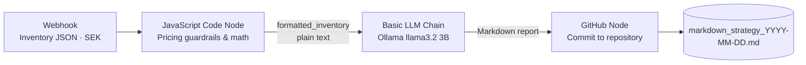

# 🏷️ Automated Retail Pricing & Markdown Optimization Pipeline

An end-to-end, locally run automation that turns raw retail inventory data into a grounded **executive pricing report** and commits it to GitHub, fully hands-off.

Built on macOS with **Docker**, **n8n**, **Ollama (llama3.2 3B)**, **JavaScript** and **GitHub**.

> **Design principle:** deterministic code does the math, the LLM only writes the narrative.

---

## 📑 Table of Contents

- [Overview](#-overview)
- [Architecture](#-architecture)
- [Tech Stack](#-tech-stack)
- [Input Payload](#-input-payload)
- [Pipeline Stages](#-pipeline-stages)
- [Issues Encountered & Fixes](#-issues-encountered--fixes)
- [Setup](#-setup)
- [Usage](#-usage)
- [Sample Output](#-sample-output)
- [Project Status](#-project-status)
- [Possible Next Steps](#-possible-next-steps)

---

## 🔎 Overview

Retail pricing teams need fast, consistent markdown recommendations. Asking an LLM to do the arithmetic is risky: it drifts, invents numbers and breaks pricing guardrails. This project separates the concerns:

| Concern | Handled by |
|---|---|
| Price floors, competitor matching, markdown %, margin % | **JavaScript Code node** (deterministic) |
| Executive Summary, Pricing Action Table, Capital Recoverable Estimate | **Local LLM** via Ollama (narrative only) |
| Versioned, auditable delivery of reports | **GitHub** (GitOps) |

Everything runs locally except the GitHub commit, so no inventory data is sent to a third-party AI service.

---

## 🏗️ Architecture



---

## 🧰 Tech Stack

| Layer | Tool |
|---|---|
| Orchestration | [n8n](https://n8n.io) (Docker) |
| Local LLM runtime | [Ollama](https://ollama.com) (Docker) |
| Model | `llama3.2` (3B) |
| Business logic | JavaScript (n8n Code node) |
| Delivery | GitHub (n8n GitHub node) |
| Host | macOS |

---

## 📥 Input Payload

The webhook accepts a JSON array of inventory items. All monetary values are in **SEK**.

| Field | Type | Description |
|---|---|---|
| `sku` | String | Unique product identifier (e.g. `SKU-4089`) |
| `product_name` | String | Plain-text product description |
| `current_price_sek` | Number | Current listing price in Swedish Kronor |
| `cost_price_sek` | Number | Wholesale or production cost, used to enforce margin floors |
| `competitor_price_sek` | Number | Competitor market price for price-matching logic |
| `days_in_stock` | Number | Inventory age, used to assess overstock risk |
| `sales_velocity_30d` | Number | Units sold in the last 30 days (sell-through momentum) |

### Example

```json
[
  {
    "sku": "SKU-4089",
    "product_name": "Pro Noise-Canceling Headphones",
    "current_price_sek": 2499,
    "cost_price_sek": 1200,
    "competitor_price_sek": 2200,
    "days_in_stock": 90,
    "sales_velocity_30d": 12
  },
  {
    "sku": "SKU-9912",
    "product_name": "Ergonomic Mesh Office Chair",
    "current_price_sek": 4500,
    "cost_price_sek": 1800,
    "competitor_price_sek": 4200,
    "days_in_stock": 45,
    "sales_velocity_30d": 28
  },
  {
    "sku": "SKU-1043",
    "product_name": "Waterproof Trail Backpack 30L",
    "current_price_sek": 899,
    "cost_price_sek": 350,
    "competitor_price_sek": 850,
    "days_in_stock": 60,
    "sales_velocity_30d": 15
  }
]
```

---

## ⚙️ Pipeline Stages

### 1. Webhook
Receives the inventory JSON payload and starts the workflow.

### 2. JavaScript Code Node: deterministic business logic
LLMs are unreliable at exact arithmetic, so this node performs **100% of the calculations** before any data reaches the model.

| Rule | Logic | Purpose |
|---|---|---|
| **Margin floor** | `cost_price_sek × 1.15` | Every recommended price keeps at least a 15% margin above cost |
| **Competitor matching** | Match the competitor price, or undercut by 2% | Stays competitive, as long as the margin floor isn't breached |
| **Data pre-formatting** | String aggregation | Bundles results into a clean plain-text string (`formatted_inventory`) |

**Pre-computed fields per SKU**

- `recommended_price_sek`
- `markdown_percent`
- `profit_margin_percent`

The output is a formatted **plain-text list** rather than nested JSON, which removes LLM parsing and calculation errors.

### 3. Basic LLM Chain + Ollama (`llama3.2` 3B)
A direct text-in, text-out step. The chain receives a strict prompt plus the `formatted_inventory` string and writes a professional Markdown narrative with:

1. **Executive Summary**
2. **Pricing Action Table**
3. **Total Capital Recoverable Estimate**

The model focuses entirely on presentation, not math.

### 4. GitHub Node: GitOps target
Commits the generated Markdown report straight into the repository, with a date-stamped filename so reports never overwrite each other, for example:

```
markdown_strategy_2026-10-23.md
```

---

## 🛠️ Issues Encountered & Fixes

| # | Issue | Root cause | Fix |
|---|---|---|---|
| 1 | **LLM hallucinations & math drift**: invented products (Coffee Maker, TV) and wrong currency (USD instead of SEK) | Complex JSON injected into an AI Agent node; the LLM was also doing arithmetic | Moved all math into a JavaScript Code node; replaced the JSON payload with a pre-formatted plain-text string; **switched from the AI Agent node to the Basic LLM Chain** to avoid agent-loop fallbacks |
| 2 | **GitHub API validation error**: `"sha" wasn't supplied` | Fields were set as literal *Fixed* strings | Configured the fields in **Expression mode (`fx`)** |
| 3 | **File name collisions & messy dates** | Static file name | Used the Luxon expression `{{ $now.toFormat('yyyy-MM-dd') }}` for unique, clean names |

### Why not the AI Agent node?
The n8n AI Agent node introduced hallucinated products and incorrect currencies earlier in the build. For a task that is purely "format this text into a report", the Basic LLM Chain is simpler, more predictable and easier to debug.

---

## 🚀 Setup

> The commands below are a starting point. Adjust ports, volumes and image tags to match your own environment.

### Prerequisites

- macOS with [Docker Desktop](https://www.docker.com/products/docker-desktop/)
- A GitHub repository for the reports and a [personal access token](https://github.com/settings/tokens) with repo write access

### 1. Run Ollama and pull the model

```bash
docker run -d --name ollama -p 11434:11434 -v ollama:/root/.ollama ollama/ollama
docker exec -it ollama ollama pull llama3.2
```

### 2. Run n8n

```bash
docker run -d --name n8n -p 5678:5678 -v n8n_data:/home/node/.n8n docker.n8n.io/n8nio/n8n
```

Open <http://localhost:5678>.

### 3. Build or import the workflow

Create the four nodes in order: **Webhook → Code → Basic LLM Chain → GitHub**.

- **Ollama Chat Model**: set the base URL so n8n can reach Ollama (e.g. `http://host.docker.internal:11434`, or the container name if both share a Docker network), and choose `llama3.2`.
- **GitHub node**: add your credentials, set owner and repository, and make sure the file path and content fields are in **Expression mode (`fx`)**.
- **File path expression** (example): `markdown_strategy_{{ $now.toFormat('yyyy-MM-dd') }}.md`

---

## ▶️ Usage

Send the inventory payload to the webhook:

```bash
curl -X POST http://localhost:5678/webhook/<your-webhook-path> \
  -H "Content-Type: application/json" \
  -d @payload.json
```

Within moments a new report appears in your GitHub repository as `markdown_strategy_<date>.md`.

---

## 📄 Sample Output

Each report contains:

- **Executive Summary**: key findings across the SKUs
- **Pricing Action Table**: per-SKU recommended price, markdown % and margin %
- **Total Capital Recoverable Estimate**: summary of the estimated recoverable capital

Reports reference the real SKUs from the payload (`SKU-4089`, `SKU-9912`, `SKU-1043`), with all figures in **SEK**.

> 💡 _Tip: paste a generated report here, or link to one in the `/reports` folder, to show the real output._

---

## ✅ Project Status

** In Progress ** The pipeline ingests inventory, applies pricing guardrails, generates a grounded executive report and pushes the commit to GitHub.

---

## 🔭 Possible Next Steps

- Add input validation and error handling on the webhook
- Schedule runs (cron) or trigger from a live inventory source
- Add automated tests for the pricing rules
- Add Slack or email notification when a new report is committed
- Make the margin floor and undercut percentage configurable

---

## 📜 License

TBD
