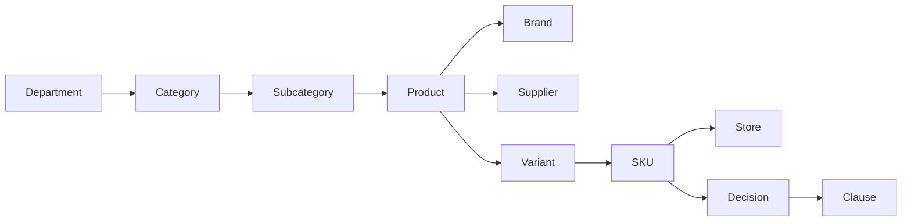

# 🏷️ Autonomous Pricing & Markdown Agent

An end-to-end, locally run **GitOps pipeline** for retail pricing. It validates inventory data, applies a rules-based pricing and markdown engine, **audits every decision against a written pricing policy**, retrieves the relevant policy clauses with **RAG**, records each decision in a **Neo4j knowledge graph**, and commits an **interactive HTML report** to GitHub.

Built on macOS with **n8n**, **Ollama** (`llama3.2`, `nomic-embed-text`), **Neo4j**, **Docker**, **JavaScript** and **GitHub**.

> **Design principle:** deterministic code makes every pricing decision and writes every number. Local LLMs are used only where text is the right output (short commentary, clause notes), and each LLM output is **verified by code before it is used**. If a check fails, the pipeline falls back to a deterministic version instead of publishing unverified text.

---

## 📑 Table of Contents

- [Overview](#-overview)
- [Architecture](#-architecture)
- [Tech Stack](#-tech-stack)
- [Repository Layout](#-repository-layout)
- [Input Payload](#-input-payload)
- [Pipeline Stages](#-pipeline-stages)
- [Policy Audit and RAG](#-policy-audit-and-rag)
- [Knowledge Graph](#-knowledge-graph)
- [The Summary Guard](#-the-summary-guard)
- [The HTML Report](#-the-html-report)
- [Design Decisions & Issues Fixed](#-design-decisions--issues-fixed)
- [Setup](#-setup)
- [Testing](#-testing)
- [Known Limitations](#-known-limitations)
- [Roadmap](#-roadmap)

---

## 🔎 Overview

Retail pricing teams need fast, consistent and explainable markdown recommendations. Asking an LLM to do the arithmetic is risky: it drifts, invents numbers and breaks pricing guardrails. This project separates the concerns:

| Concern | Handled by |
|---|---|
| Data validation, GTIN check, duplicate detection | **JavaScript** (`Validate & Normalise`) |
| Price floors, competitor undercutting, aging and stock-cover markdowns, price endings, action labels | **JavaScript** (`Pricing_Engine_JS`) |
| Independent re-check of every decision against the policy parameters | **JavaScript** (`Policy_Audit_JS`) |
| Finding which policy clauses matter for a flagged SKU | **RAG**: embeddings from `nomic-embed-text`, cosine similarity in code |
| One-to-two sentence clause notes | **Local LLM**, with citations and numbers verified (`Policy_Collect_JS`) |
| Relationships between products, variants, stores, decisions and clauses | **Neo4j** (`Graph_Sync_JS`) |
| Optional short commentary (3 to 4 sentences) | **Local LLM**, verified by the summary guard (`Report_Assembly_JS`) |
| Executive summary, KPIs, tables, charts | **JavaScript**, always computed from the facts |
| Versioned, auditable delivery of the report | **GitHub** (GitOps) |

The LLMs run locally, so inventory data is not sent to a third-party AI service. The only external call is the GitHub commit.

---

## 🏗️ Architecture

```mermaid
flowchart LR
    A["Webhook<br/>Inventory JSON, SEK"] --> B["Validate & Normalise"]
    B --> C{"Valid rows?"}
    C -- "rejected" --> R["Rejected rows"]
    C -- "valid" --> D["Pricing_Engine_JS<br/>decisions + facts"]
    D --> E["Policy_Audit_JS<br/>recompute rules, chunk policy"]
    E --> F["Embed_Policy<br/>Ollama nomic-embed-text"]
    F --> G["Policy_Retrieve_JS<br/>top-3 clauses per flagged SKU"]
    G --> H["Policy_Notes_Chain<br/>Ollama llama3.2"]
    H --> I["Policy_Collect_JS<br/>verify notes, build Policy Review"]
    I --> J["Graph_Sync_JS<br/>Neo4j write + insight queries"]
    J --> K["Basic LLM Chain<br/>optional commentary"]
    K --> L["Report_Assembly_JS<br/>Summary Guard"]
    L --> M["Report_HTML<br/>self-contained page"]
    M --> N["Create HTML File<br/>GitHub commit"]
    L -. "disabled" .-> O["Create MD File"]
```



All nodes sit on one main path. The two optional enrichments (policy notes and the graph) are built to **degrade gracefully**: if the embedding call fails or Neo4j is down, the run still produces a complete report and says which part was unavailable.

---

## 🧰 Tech Stack

| Layer | Tool |
|---|---|
| Orchestration | [n8n](https://n8n.io) (Docker) |
| Local LLM runtime | [Ollama](https://ollama.com), native on macOS (Apple GPU) |
| Chat model | `llama3.2:latest` (3B) for commentary and clause notes |
| Embedding model | `nomic-embed-text` |
| Knowledge graph | [Neo4j](https://neo4j.com) 5.x (Docker), queried through the HTTP Query API |
| Business logic | JavaScript (n8n Code nodes) |
| Report | One self-contained HTML file, no external libraries |
| Delivery | GitHub (n8n GitHub node) |
| Tested on | MacBook M1, 8 GB RAM |

---

## 📁 Repository Layout

Suggested structure for publishing:

```
.
├── README.md
├── workflow/
│   └── Autonomous Pricing & Markdown Agent_RAG.json   # n8n workflow export (no credentials)
├── policy/
│   └── pricing_policy.md                              # the policy that is embedded in Policy_Audit_JS
├── code/
│   ├── validate_and_normalise.js
│   ├── pricing_engine.js
│   ├── policy_audit.js
│   ├── policy_retrieve.js
│   ├── policy_collect.js
│   ├── graph_sync.js
│   ├── report_assembly.js                             # report assembly + summary guard
│   ├── report_html.js
│   └── llm_prompt.txt                                 # Basic LLM Chain prompt
├── sample-data/
│   └── ...                                            # synthetic payloads (clean and with errors)
├── docker-compose.yml                                 # n8n + Neo4j (see Setup)
└── case-studies/autonomous-pricing-markdown/
    └── index.html                                     # latest generated report
```

---

## 📥 Input Payload

The webhook accepts inventory items as JSON (an array, or single objects). All monetary values are in **SEK**.

| Field | Type | Required | Description |
|---|---|---|---|
| `sku` | String | ✅ | Unique identifier of the stocked item (one per product variant and store) |
| `gtin` | String | optional | GTIN-8/12/13/14, validated with the GS1 check digit |
| `product_name` | String | ✅ | Plain-text product description |
| `variant` | String | optional | Variant of the product (for example colour or size); defaults to `Standard` in the graph |
| `store` | String | optional | Store that holds the stock; defaults to `Unknown` in the graph |
| `brand` | String | optional | Brand |
| `department` | String | ✅ | Top of the hierarchy; selects the margin floor |
| `category` | String | ✅ | Product category |
| `subcategory` | String | optional | Product subcategory |
| `supplier` | String | optional | Supplier |
| `cost_price_sek` | Number | ✅ | Wholesale or production cost (must be > 0) |
| `current_price_sek` | Number | ✅ | Current listing price (must be > 0) |
| `competitor_prices_sek` | Number[] | optional | One or more competitor prices; empty or missing is allowed with a warning |
| `days_in_stock` | Number | ✅ | Inventory age in days |
| `units_in_stock` | Integer | ✅ | Units on hand |
| `sales_velocity_30d` | Number | ✅ | Units sold in the last 30 days |
| `days_since_last_price_change` | Number | optional | Used for the price-change cooldown |

The legacy single field `competitor_price_sek` is still accepted.

`variant` and `store` let one product appear in several rows: the same product and variant (one GTIN) can be stocked in different stores under different SKUs, which is what the knowledge graph uses to compare stores.

### Example item

```json
{
  "sku": "SKU-4089-STO",
  "gtin": "7350001000015",
  "product_name": "Pro Noise-Canceling Headphones",
  "variant": "Black",
  "store": "Stockholm",
  "brand": "Nordtone",
  "department": "Electronics",
  "category": "Audio",
  "subcategory": "Headphones",
  "supplier": "Sonic Supply AB",
  "cost_price_sek": 1200,
  "current_price_sek": 2499,
  "competitor_prices_sek": [2199, 2249, 2179],
  "days_in_stock": 78,
  "units_in_stock": 140,
  "sales_velocity_30d": 2,
  "days_since_last_price_change": 45
}
```

---

## ⚙️ Pipeline Stages

### 1. Webhook (POST)
Receives the inventory payload and starts the workflow.

### 2. Validate & Normalise
A data-quality gate that runs before any pricing logic. Each row is **accepted**, **accepted with warnings**, or **rejected**.

| Result | Triggers |
|---|---|
| ❌ **Rejected** (not priced) | Missing `sku`, `product_name`, `department` or `category`; duplicate `sku`; non-numeric or non-positive cost or price; invalid stock, age or velocity values; invalid GTIN format or GS1 check digit; non-numeric competitor values |
| ⚠️ **Warning** (still priced) | Missing GTIN; current price below cost; no competitor prices; competitor price that looks like an outlier; stock older than 730 days |

The node also **normalises** the data: numeric strings become numbers (a decimal comma is accepted), it unwraps the webhook body, and it derives competitor min, median and max. The `Valid rows?` IF node routes rejected rows to `Rejected rows` (kept with their raw input for review); valid rows continue.

### 3. Pricing_Engine_JS
All pricing decisions and calculations happen here, in plain JavaScript.

**Decision order for each SKU**

| # | Check | Outcome |
|---|---|---|
| 1 | No stock on hand | `HOLD` |
| 2 | Current price is below the margin floor | `REVIEW` (never raised automatically) |
| 3 | Price changed in the last 14 days | `HOLD` (cooldown) |
| 4 | Fast mover: 8 weeks of cover or less **and** 60 days in stock or less | `HOLD` |
| 5 | Otherwise: target = the lower of (cheapest credible competitor minus 2%) and (current price minus the stock-pressure markdown) | `MARKDOWN` or `CLEARANCE` |

**Guardrails applied to the target price**

- **Margin floor by department:** `cost × (1 + markup)`: Electronics +10%, Furniture +25%, Outdoor, Home and Sports +20%, others +15%.
- **Maximum markdown:** no price falls more than 25% in a single run.
- **Competitor outliers:** competitor prices below 50% of our price are ignored.
- **Price endings:** prices round **up** to the next number ending in 9, never above the current price.
- **Minimum step:** changes under 1% are ignored.

**Stock-pressure markdown** (capped at 30% in total)

| Days in stock | Depth | | Weeks of cover | Depth |
|---|---|---|---|---|
| 0 to 30 | 0% | | up to 8 | 0% |
| 31 to 60 | 3% | | 9 to 13 | 3% |
| 61 to 90 | 8% | | 14 to 26 | 6% |
| 91 to 120 | 15% | | 27 to 52 | 12% |
| over 120 | 25% | | over 52 | 20% |

Weeks of cover = `units_in_stock ÷ (sales_velocity_30d × 7 ÷ 30)`.

**Action labels**

| Label | Meaning |
|---|---|
| `HOLD` | Price unchanged (fast mover, cooldown, no stock, or change too small) |
| `MARKDOWN` | Price reduced |
| `CLEARANCE` | Price reduced, with 120+ days in stock **and** 26+ weeks of cover |
| `REVIEW` | Current price is below the margin floor; needs a human decision |

Markdowns of **15% or more** are flagged for human approval.

**Deterministic outputs**

- Per-SKU recommended price, markdown %, margin % (on selling price), weeks of cover and a plain-text reason
- A structured `facts` object and a `fallback_summary` (the Executive Summary, built from a template filled with the calculated figures)
- A `facts_for_llm` text block for the language model
- The capital estimate (below)

All thresholds live in a single `CONFIG` object at the top of the node.

**Capital metrics** (for `MARKDOWN` and `CLEARANCE` SKUs only)

| Metric | Formula |
|---|---|
| Capital tied up at cost | Σ `units × cost` |
| **Total Capital Recoverable Estimate** | Σ `units × recommended price` (cash recovered if all units sell at the new prices) |
| Margin earned at recommended prices | Σ `units × (recommended − cost)` |
| Revenue given up | Σ `units × (current − recommended)` |

These assume all units sell, so they are not time-adjusted for sales velocity.

### 4. Policy audit and RAG
`Policy_Audit_JS`, `Embed_Policy`, `Policy_Retrieve_JS`, `Policy_Notes_Chain` and `Policy_Collect_JS`. See [Policy Audit and RAG](#-policy-audit-and-rag).

### 5. Graph_Sync_JS
Writes the run into Neo4j and reads back insight queries. See [Knowledge Graph](#-knowledge-graph).

### 6. Basic LLM Chain (optional commentary)
A Basic LLM Chain with Ollama (`llama3.2`) receives only the `facts_for_llm` block and writes a 3 to 4 sentence commentary on what stands out. The prompt allows at most four numbers and forbids headings, tables, charts, code blocks, new calculations, rounding, and wording that presents projected figures as realised losses. The model never touches the pricing table, the executive summary or the capital estimate.

### 7. Report_Assembly_JS
Runs the [summary guard](#-the-summary-guard) on the commentary and assembles the Markdown report (executive summary, optional commentary, pricing table, capital estimate, policy review, data quality, chart). It also outputs `llm_commentary` (`included` or `omitted`) and `guard_problems`, which are visible in the n8n execution data.

### 8. Report_HTML and Create HTML File
`Report_HTML` builds the [interactive HTML report](#-the-html-report). The `Create HTML File` GitHub node commits it to `case-studies/autonomous-pricing-markdown/index.html` with the commit message `feat: update latest markdown report [ci skip]`.

The node uses the GitHub **edit** operation, so the file must already exist in the repository (create a placeholder `index.html` once). Each run overwrites the latest report; the history of every report is in the Git commit history. The older `Create MD File` node, which committed a timestamped Markdown report per run, is still in the workflow but **disabled**.

---

## 📚 Policy Audit and RAG

The policy is a short, numbered document (`policy/pricing_policy.md`, 10 sections, clauses `P-1.1` to `P-10.1`). Its text is embedded as a constant inside `Policy_Audit_JS` and ends with a machine-readable `policy-parameters` JSON block. Keeping the parameters in the policy means the engine and the audit can be checked against each other.

### Step 1: deterministic audit (`Policy_Audit_JS`)
Every SKU decision is **recomputed from the policy parameters** and compared with what the engine produced. This is a second, independent implementation of the rules.

| Clause | Check |
|---|---|
| P-2.1 | Engine margin floor equals the policy floor; recommended price is not below it |
| P-3.1 | Markdown does not exceed the per-run maximum |
| P-3.2 | A change is not below the minimum step |
| P-3.3 | A reduced price ends in 9 |
| P-3.4 | The price is never increased |
| P-4.1 | The approval flag matches the approval threshold |
| P-6.1 | A fast mover was not marked down |
| P-8.1 | `CLEARANCE` is used exactly when the clearance criteria are met |

The result is `policy_audit.violations` (empty when the run passes). The policy is also split into **one chunk per clause**, and the SKUs that deserve a clause review are selected: any SKU with a violation, any `REVIEW`, and any price reduction, ranked by severity, with a cap of **12 SKUs per run**.

### Step 2: embeddings (`Embed_Policy`)
One HTTP call to Ollama's `/api/embed` with `nomic-embed-text` embeds all policy chunks (`search_document:` prefix) and one query per flagged SKU (`search_query:` prefix) in a single batch.

### Step 3: retrieval (`Policy_Retrieve_JS`)
Cosine similarity in code, then three adjustments:

- **Metadata filter:** a clause that says `Applies to: <departments>` is only considered for those departments.
- **Boosts:** small score boosts when the clause names the SKU's department or action, and for the approvals section when approval is required.
- **Top 3 clauses** per SKU are passed on, together with a prompt that contains the decision and only those clauses.

If the embedding call fails or returns an unexpected shape, the node emits a single "unavailable" item and the run continues without a clause review.

### Step 4: AI clause notes (`Policy_Notes_Chain`)
`llama3.2` at **temperature 0** answers in one or two sentences which clause (if any) requires a human action, citing clause IDs in square brackets.

### Step 5: verification (`Policy_Collect_JS`)
Each note is checked before it is used:

- it must cite at least one clause (or be exactly `No policy issue.`)
- it may only cite clauses that were actually retrieved for that SKU
- every number in it must appear in the decision text or the retrieved clauses
- it must be at most 450 characters

A note that fails is **replaced by the list of retrieved clauses** and marked `(auto)`. The result is the **Policy Review** section: the audit result, plus a table of SKU, action, clauses retrieved and policy note.

---

## 🕸️ Knowledge Graph

`Graph_Sync_JS` writes every run into **Neo4j** through the HTTP Query API (`/db/neo4j/query/v2`) and then reads back insights. It passes its input through unchanged and adds a `graph` field, so if Neo4j is unreachable the run continues with `graph.available = false` and the report says so.

### Model



| Relationship | Meaning |
|---|---|
| `HAS_CATEGORY`, `HAS_SUBCATEGORY`, `HAS_PRODUCT` | Product hierarchy |
| `BY_BRAND`, `SUPPLIED_BY` | Product to brand and supplier |
| `HAS_VARIANT` | Product to variant (the variant carries the GTIN) |
| `STOCKED_AS` | Variant to the SKU that stocks it |
| `AT_STORE` | SKU to store |
| `HAS_DECISION` | SKU to the decision of one run (`Decision.id = sku@run_id`) |
| `BECAUSE_OF` | Decision to the policy clause(s) behind it |

Uniqueness constraints are created on SKU, Variant, Product, Decision and Clause. Writes use `MERGE`, so the graph **accumulates across runs** and each run's decisions stay separate through `run_id`.

The decision-to-clause mapping is deterministic (no LLM): an approval maps to P-4.1, clearance to P-8.1 (and P-4.2 in Furniture and Electronics), `REVIEW` to P-2.2 and P-4.3, a fast mover to P-6.1, a cooldown to P-5.1, a cap to P-3.1, the margin floor to P-2.1, a competitor-driven price to P-7.1, stock pressure to P-6.2, and stock at cost above 150,000 SEK to P-4.4.

### Insights shown in the report

| Insight | Question it answers |
|---|---|
| **Move stock before you discount** | Is the same variant marked down 15% or more in one store (20+ weeks of cover) while another store holds it with under 4 weeks of cover? |
| **Same product, different prices** | Does one variant (one GTIN) carry different current prices in different stores? |
| **Policy clauses behind the decisions** | Which clauses drive the most decisions and the most revenue given up? |
| **Revenue given up by store** | Where does the markdown cost land? |
| Node and relationship counts | Size of the graph after the run |

These cross-store questions are the reason for the graph: a flat table cannot show that a markdown in one store may be avoidable by moving stock from another.

---

## 🛡️ The Summary Guard

Small local models copy numbers well but can misstate what they mean. In testing, the LLM once described the largest single markdown as the average, and once claimed that all 15 SKUs had been repriced when only 14 were. A guard in `Report_Assembly_JS` checks the commentary before it is published.

| Tier | Check | Example it catches |
|---|---|---|
| **0. SKUs** | Every SKU mentioned exists, a percentage next to a SKU is that SKU's own markdown, and every SKU listed next to "approval" is actually flagged for approval | "SKU-4102 needs approval" when its markdown is 0% |
| **1. Numbers** | Every number appears in the verified facts (SKU codes and product names are ignored) | An invented "67%" |
| **2. Claims** | Each number must match the topic word nearest to it: average markdown, largest markdown, markdown cap, capital tied up, recoverable capital, revenue given up, counts of held, marked down, clearance, repriced SKUs, approvals | "The average markdown was 24.9%" when the average is 20% |

If the commentary fails any tier, it is **left out of the report** and the Data Quality section lists each problem. The Executive Summary is unaffected, because it never came from the LLM.

**How it was developed.** Running it on real LLM output exposed both types of error: correct sentences rejected (for example "10 markdowns across 15 SKUs", or SKU numbers written without the `SKU-` prefix) and, once, a wrong sentence accepted ("15 SKUs underwent price adjustments"). Each case was fixed in the rules and added to the test set. The guard is a rule-based checker, not a language model, so unusual phrasings can still be rejected. A rejection only costs you the optional commentary.

The same idea, **verify before you trust**, is used for the policy clause notes (citations and numbers checked, deterministic fallback).

---

## 🖥️ The HTML Report

`Report_HTML` produces **one self-contained HTML file** (no external libraries, no network requests, adapts to light and dark mode). Everything comes from the calculated facts.

| Section | Content |
|---|---|
| **KPI cards** | SKUs analysed, needs approval, average markdown, capital tied up, recoverable capital, revenue given up |
| **Executive summary** | The deterministic summary |
| **Action mix** | Proportional bar of `HOLD`, `MARKDOWN`, `CLEARANCE`, `REVIEW` |
| **Revenue given up by department** | Bars with average markdown and number of SKUs changed |
| **Pricing actions** | Sortable, searchable table with filters (action, needs approval). Click a row to see its **path in the graph** (department > category > subcategory > product > variant > SKU @ store), the clauses behind the decision, the reasons, and the same variant in other stores |
| **Knowledge graph insights** | The insight tables above |
| **Policy review** | Audit result and the verified clause notes |
| **Data quality** | Rows received, accepted, rejected and warned, with the warnings |

The footer states whether the AI commentary was included or omitted. The commentary text itself is part of the Markdown report (see [Known Limitations](#-known-limitations)).

> Add a screenshot here after publishing, for example `docs/report-screenshot.png`.

---

## 🛠️ Design Decisions & Issues Fixed

| # | Issue | Root cause | Fix |
|---|---|---|---|
| 1 | **LLM hallucinations and math drift**: invented products and the wrong currency | Complex JSON injected into an AI Agent node; the LLM was also doing the arithmetic | Moved all math into JavaScript; switched from the AI Agent node to the **Basic LLM Chain** |
| 2 | **GitHub API error**: `"sha" wasn't supplied` | Fields were set as literal *Fixed* strings | Configured the fields in **Expression mode (`fx`)** |
| 3 | **File name collisions** | Static file name | Luxon timestamp expression for the Markdown report; the HTML report is a single "latest" file with history in Git |
| 4 | **LLM misreporting figures in its summary** | A 3B model copies numbers well but is unreliable at drawing conclusions | Executive summary, tables and capital estimate are written by code; the LLM only adds optional commentary |
| 5 | **Naive markdowns**: a fast-selling item was marked down just because a competitor was cheaper | The first engine used only price, cost and one competitor price | Added velocity, stock cover, aging tiers, cooldown and fast-mover rules |
| 6 | **Bad data silently flowing into pricing** | No input checks | Validation gate with a GS1 check-digit test and a rejected-rows branch |
| 7 | **Wrong LLM claims reaching the report** | Free-text output cannot be trusted | Summary guard: commentary is published only if every number and claim matches the calculated facts |
| 8 | **Guard rejecting correct sentences** | First rules assigned one topic per clause and did not know about caps, thresholds or bare SKU numbers | Matched each number to its nearest topic word; separated rules from results; added tests for each case found |
| 9 | **Engine and policy could drift apart** | Rules lived only in the engine code | Policy parameters are machine-readable; `Policy_Audit_JS` recomputes every decision independently |
| 10 | **LLM citing clauses that do not apply** | Free-text policy notes | Retrieval limited to 3 clauses per SKU; notes may cite only retrieved clauses and numbers from the decision; fallback to the clause list |
| 11 | **n8n could not reach Neo4j or Ollama** | `localhost` inside a container is the container itself | n8n and Neo4j share a Docker network (`http://neo4j:7474`); Ollama is reached at `host.docker.internal:11434` |
| 12 | **Slow, memory-hungry local models on 8 GB** | Ollama in Docker has no GPU access on macOS | Ollama runs natively on macOS (Apple GPU); Docker memory limits lowered; embeddings are batched in a single call |

### Why not the AI Agent node?
The n8n AI Agent node introduced hallucinated products and incorrect currencies earlier in the build. For "turn these facts into a short text", the Basic LLM Chain is simpler, more predictable and easier to debug. An agent is on the [roadmap](#-roadmap) for the **decision layer**, with the deterministic engine and the policy audit as its guardrails.

### Why is the executive summary not written by the LLM?
Because every figure in it must be correct. A template filled with calculated values is correct by construction. The LLM adds tone and emphasis only where its text can be checked.

---

## 🚀 Setup

> The commands below are a starting point. Adjust ports, volumes, image tags and memory limits to your environment.

### Prerequisites

- macOS with [Docker Desktop](https://www.docker.com/products/docker-desktop/) and [Ollama](https://ollama.com/download)
- A GitHub repository for the reports and a GitHub credential in n8n with write access

### 1. Ollama (native) and models

```bash
ollama pull llama3.2
ollama pull nomic-embed-text
```

### 2. n8n and Neo4j

A minimal `docker-compose.yml` (both containers share a network, so n8n can reach Neo4j as `neo4j`):

```yaml
services:
  n8n:
    image: docker.n8n.io/n8n-io/n8n
    ports: ["5678:5678"]
    volumes: ["n8n_data:/home/node/.n8n"]
    extra_hosts: ["host.docker.internal:host-gateway"]
  neo4j:
    image: neo4j:5
    ports: ["7474:7474", "7687:7687"]
    environment:
      NEO4J_AUTH: neo4j/<choose-a-password>
    volumes: ["neo4j_data:/data"]
volumes:
  n8n_data:
  neo4j_data:
```

```bash
docker compose up -d
```

Open n8n at <http://localhost:5678> and Neo4j Browser at <http://localhost:7474>. The graph node uses the Query API, which needs a recent Neo4j 5.x release.

### 3. Import and configure the workflow

1. In n8n, choose **Import from file** and select the workflow JSON from `workflow/`.
2. **Ollama Chat Model** and **Ollama Chat Model (policy)**: create an Ollama credential with base URL `http://host.docker.internal:11434` and select `llama3.2:latest`.
3. **Embed_Policy:** the URL is `http://host.docker.internal:11434/api/embed`; change it if your Ollama runs elsewhere.
4. **Graph_Sync_JS:** set the Neo4j URL (`http://neo4j:7474/db/neo4j/query/v2` inside the compose network), user and password in the `NEO4J` constant. **Do not commit a real password.** Replace it before sharing the export, or read it from an n8n credential or environment variable.
5. **Create HTML File:** add your GitHub credential and set your own owner, repository and path. Keep the file path and content fields in **Expression mode (`fx`)**. Because the node uses the **edit** operation, create a placeholder `index.html` at that path first.
6. Keep the node names unchanged (`Pricing_Engine_JS`, `Validate & Normalise`, `Policy_Audit_JS`, `Policy_Retrieve_JS`, `Policy_Collect_JS`, `Graph_Sync_JS`, `Report_Assembly_JS`), because Code nodes refer to each other by name.
7. Activate the workflow.

> Credentials are not included in the workflow file; create your own.

---

## 🧪 Testing

**Inside n8n (no terminal needed)**

1. Open the Webhook node and unpin any old data.
2. In the output panel, choose **Set mock data** (or **Edit Output**) and paste a sample payload from `sample-data/`.
3. Click **Execute workflow**.
4. Check: `Validate & Normalise` lists all rows, valid rows go on to pricing, rejected rows land in `Rejected rows`. After the run, `Policy_Collect_JS` shows `policy_audit.passed`, `Graph_Sync_JS` shows `graph.available`, and `Report_Assembly_JS` shows `llm_commentary` and `guard_problems`.

To avoid committing a test report, deactivate the `Create HTML File` node while testing.

**Against the real webhook**

```bash
curl -X POST http://localhost:5678/webhook-test/<your-webhook-id> \
  -H "Content-Type: application/json" \
  -d @sample-data/<payload>.json
```

Use the `webhook-test` URL after clicking **Listen for test event**, or the `webhook` URL once the workflow is active.

**Inspecting the graph.** In Neo4j Browser, for example:

```cypher
// the path behind one decision
MATCH path = (:Department)-[:HAS_CATEGORY]->(:Category)-[:HAS_SUBCATEGORY]->(:Subcategory)
             -[:HAS_PRODUCT]->(:Product)-[:HAS_VARIANT]->(:Variant)-[:STOCKED_AS]->(s:SKU {sku: 'SKU-4089-STO'})
             -[:HAS_DECISION]->(d:Decision)-[:BECAUSE_OF]->(:Clause)
RETURN path LIMIT 5;

// clauses that drive the most decisions
MATCH (d:Decision)-[:BECAUSE_OF]->(c:Clause)
RETURN c.id, c.title, count(d) AS decisions ORDER BY decisions DESC;
```

**Built-in checks.** Three independent checks run on every execution: the input validation, the **policy audit** (the engine's decisions recomputed from the policy parameters) and the **summary guard**. Beyond that:

- Pricing invariants were tested outside n8n: no price rises, no price below its margin floor, no markdown above the 25% cap.
- The guard was tested against a set of 46 correct and 33 incorrect commentary sentences. All correct sentences passed and all incorrect ones were rejected, including the real LLM mistakes described above. This test set is not in the repository yet (see the roadmap).

---

## ⚠️ Known Limitations

- **The guard is rule-based.** It verifies the numbers and claim types it knows about. It cannot judge tone or a made-up qualitative statement, and an unusual but correct phrasing may be rejected. The consequence is limited: the optional commentary is omitted.
- **The HTML report shows only the commentary status.** The commentary text is part of the Markdown report, and the Markdown node is currently disabled. Re-enable `Create MD File` (its content field must read `{{ $json.text }}` from `Report_Assembly_JS`) or add the commentary to `Report_HTML` if you want it published.
- **The policy audit covers the clauses it can compute.** P-2.1, P-2.2 (through the `REVIEW` label), P-3.1 to P-3.4, P-4.1, P-6.1 and P-8.1 are checked. Escalation and timing clauses (P-4.2, P-4.4, P-5.2) and seasonality (P-8.2) are retrieved and shown to a reviewer but are **not enforced or verified by code** yet.
- **Approval is a flag, not a gate.** Markdowns of 15% or more are flagged in the report but are not blocked or routed to a human yet.
- **Clause review is capped** at 12 SKUs per run, ranked by severity.
- **Clause notes come from a 3B model.** The verification keeps them safe, but many notes can fall back to the plain clause list.
- **The graph needs the same structure in every run.** The graph is only as useful as the `variant` and `store` fields in the payload; without them everything lands under `Standard` and `Unknown`.
- **Neo4j credentials are in the Code node** in the current export. Move them to a credential or environment variable before publishing.
- **Capital figures assume every unit sells**, and are not time-adjusted for sales velocity.
- **Sample data is synthetic**, built to exercise the rules (overstock, fast movers, cooldowns, variants across stores, bad rows). Thresholds in `CONFIG` are reasonable starting points, not tuned to a real retailer.
- **The pipeline recommends prices; it does not change them anywhere.** The only write outside Neo4j is the report commit.
- **No price increases:** the engine only holds or lowers prices.
- **Local hardware:** on an 8 GB machine, running two models, Docker and Neo4j at the same time puts the system under memory pressure. Keep Docker's memory limit low and run one model at a time.

---

## 🔭 Roadmap

- [x] Input validation gate with GS1 check-digit test and rejected-rows branch
- [x] Rules-based pricing engine: aging, stock cover, department floors, markdown cap, price endings, cooldown
- [x] Deterministic executive summary, tables, capital estimate and data-quality section
- [x] Summary guard for the LLM commentary
- [x] Policy document with machine-readable parameters and an independent audit of every decision
- [x] RAG over the policy: embeddings, metadata filter, top-3 retrieval, verified clause notes
- [x] Knowledge graph in Neo4j with cross-store insights
- [x] Interactive HTML report published through GitHub
- [ ] **MCP and an AI agent in the decision layer**, using the audit and the guards as guardrails
- [ ] **Approval branch:** route flagged items to Slack or email for human approval before they are committed
- [ ] Enforce and audit P-4.2, P-4.4, P-5.2 and P-8.2 (escalations, cooldown exception, seasonality)
- [ ] Engine emits clause IDs directly instead of the keyword mapping used by the graph
- [ ] Ship the guard test set and a test runner in the repository
- [ ] Machine-readable `decisions.json` or CSV committed next to each report
- [ ] Scheduled runs and a real inventory source instead of a manual webhook call
